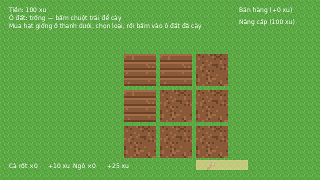

# Tiny Farm

Game Idle/Farming 2D viết bằng **Godot 4.6** + **GDScript**.

## Tài liệu

| Tài liệu | Nội dung |
| --- | --- |
| [`idea/idea.md`](idea/idea.md) | Thiết kế tổng thể, roadmap theo phase, checklist nghiệm thu |
| [`docs/architecture.md`](docs/architecture.md) | Cấu trúc scene, node, script và luồng dữ liệu |
| [`docs/gameplay.md`](docs/gameplay.md) | Vòng lặp gameplay, cân bằng kinh tế, công thức cây trồng |
| [`docs/known_issues.md`](docs/known_issues.md) | Lỗi đã biết và hạn chế tạm thời |
| [`docs/assets.md`](docs/assets.md) | Nguồn, license và cách cài asset bên thứ ba |

## Current reference screenshot



Đây là ảnh tham chiếu hiện trạng của project theo layout farm 3x3, HUD, toolbar và asset từ pack gốc. File lưu tại [`docs/screenshots/actual_game_reference.png`](docs/screenshots/actual_game_reference.png).

## Chạy game

```bash
# Mở trong editor
godot --path .

# Chạy thẳng, không mở editor
godot --path .
```

## Asset bên thứ ba

Asset pack **không** được commit vào repo (license cấm redistribute trên repo public).
Clone repo rồi làm theo [`docs/assets.md`](docs/assets.md) để tải và đặt asset vào `assets/packs/`.

| Pack | Nguồn |
| --- | --- |
| Pixel Top-down Farm Tileset (16×16) | <https://reodesuxz.itch.io/free-pixel-top-down-farm-tileset-16x16> |

## Chơi

```bash
godot --path .
```

1. Chọn loại hạt giống ở thanh dưới màn hình (nút vàng = đang chọn).
2. Mua thêm hạt giống nếu cần (nút `+10 xu` / `+25 xu`).
3. Bấm vào ô đất để cày, bấm lần nữa để gieo hạt.
4. Đợi cây chín, bấm để thu hoạch.
5. Bấm `Bán hàng` để đổi nông sản lấy tiền, rồi `Nâng cấp` để cây mọc nhanh hơn.

## Kiểm thử

```bash
godot --path . --script tests/test_crop_plot_loop.gd
```

Chạy vòng đời ô đất (cày → gieo → lớn → chín → thu hoạch) và in PASS/FAIL cho từng bước.

## Export

Bấm **Project → Export** trong editor, chọn preset Linux, xuất ra `build/`.
